# Tollgate

**Verify before you pay.** A payment firewall that sits between an AI agent and its wallet.

An agent that can pay can be tricked into paying. The payment request arrives from an untrusted server, and the agent usually follows it: an inflated price, a swapped payee, a fake deposit address, a hijacked refund, a replay after a timeout, or a prompt injection that talks the agent into paying out of scope. Today's guards mostly cap *how much* a wallet can spend. They do not verify that *this* request is the one the human meant to allow.

Tollgate checks every machine payment request against a mandate the human wrote (who, what, how much, until when) and against facts it fetches itself, then returns `ALLOW`, `DENY` or `NEEDS_APPROVAL`. Only an `ALLOW` produces a signature, and the signature is bound to the exact decision that was approved.

Tollgate is **wallet-agnostic**: it is the verification layer in front of any wallet, not another custody product. It never holds your funds beyond a small signer float.

Built for **NEAR HACKATHON**, tracks `security` (AI Security & Defense) and `agents` (Agent Economy). Build window 1–14 Nov 2026.

---

## For reviewers: five minutes, no keys, no network

Run from the repo root (Node 22+, pnpm 10+). Each step says what you should see.

| # | Do this | See this |
| --- | --- | --- |
| 1 | `pnpm install` | Ends with `Done in ...s`. |
| 2 | `pnpm bench` | 16 attacks and 5 benign payments against three targets. Last lines: naive agent `0/16`, modelled stock policy `5/16`, **Tollgate `16/16`**, `5/5` benign allowed, and `Every result matched what was written down before the run.` |
| 3 | `pnpm demo` | An agent haggles, buys, waits for approval, hires, earns (from a labelled **simulated** customer), meets dishonest merchants, and hits the kill switch. A banner says what is real and what is simulated. |
| 4 | `pnpm --filter @tollgate/mobile test`, `pnpm --filter @tollgate/mobile test:ui` and `pnpm --filter @tollgate/mobile typecheck` | The phone app's checks: 74 logic tests, then 19 UI tests pass (93 in all), the type check is clean. |
| 5 | `pnpm --filter @tollgate/docs test` | The documentation site builds and its 8 checks pass: every page, link, anchor and image resolves, and nothing secret-shaped is published. |
| 6 | Open <https://docs.trytollgate.xyz> | The 40-page documentation site, live. Start at [Life of a payment](https://docs.trytollgate.xyz/life-of-a-payment/) and [Phone app: every screen](https://docs.trytollgate.xyz/phone-screens/). |
| 7 | Optional, needs internet but no key: `pnpm nearai:attest` | NEAR AI Cloud's gateway and model enclaves checked live against a fresh nonce: two `bound in a fresh TDX quote` lines, written to `bench/results/nearai-attestation.json`. |

The phone app needs an iPhone or simulator and, for real payments, your own keys, so it is not part of this offline path.
Its tests and its screen-by-screen description are. The full list of what is built, simulated and not built is next.

---

## Status

What exists, what is simulated, and what is not built. Written for a reviewer who has not seen the code.

| Part | State |
| --- | --- |
| Gateway: 12 checks, budget ledger, approvals, kill switch, audit chain, negotiation, hiring, earning | **Built and tested.** All state in Postgres (the server refuses to start without `DATABASE_URL`). |
| Signer: signs a USDC transfer only for a stored ALLOW, once, within its own limits | **Built and tested (118 tests).** It signs **a NEP-141 `ft_transfer` of USDC on NEAR** (`SIGNER_CHAINS=near,near:mainnet`) and nothing else; it never broadcasts a payment. That rail has made one real payment (3 Nov 2026, see below). It also signs **withdrawals** back to one account fixed in its own config (see "Withdraw" below). |
| SDK: wraps `fetch`, handles a 402 end to end | **Built and tested** against the real gateway and signer. Published on npm as [`trytollgate`](https://www.npmjs.com/package/trytollgate) (source in `packages/sdk`). TypeScript only: other languages call the gateway's HTTP API (examples in Python and Go under `e2e/examples`). |
| Benchmark: 16 attacks, 5 controls, 3 targets | **Built.** Offline. See `bench/README.md` for what is real and what is scripted. |
| Demo (`pnpm demo`): buy, haggle, hire, earn, attacks, kill switch | **Built.** Real gateway, signer and SDK; everything outside them is simulated and labelled. |
| Mock merchants, fake 1Click server, simulated chain, poisoned directory | **Built.** Test doubles, labelled as simulated. |
| Marketing site and `/docs/` page | **Built** (`apps/site`). |
| Phone app (`apps/mobile`) | **Built, tested offline and by hand.** Logic: 74 tests. Screens: 19 automated UI tests (Jest and React Native Testing Library; see "The phone app"). By hand: the author built the app and ran it end to end on their own iPhone 15 Pro, Face ID included (the author's statement; no recording of that session is in this repository, and the screenshots in "The phone app" are from the build on that phone, which is older than the current code). No App Store build. Pair with a QR code, approve or reject with Face ID, kill switch, every decision with its checks, agents and chats, top up, **withdraw**. Holds no wallet key. Alerts are local notifications while the app runs, not push. |
| Withdraw (take USDC back out of the signer's NEAR account) | **Built, tested offline, and run once for real.** 0.14 USDC to the owner's own account on 11 Nov 2026 ([transaction](https://nearblocks.io/txns/Sr7ib9jxvCDg9QcqdyN4qotujdYGeu4UdDXuGP1Ex8T)). An earlier attempt on 9 Nov was refused by the NEAR node (`INVALID_TRANSACTION`, nothing moved); its cause is not identified. See "Withdraw". The destination is set only in the signer's config (`SIGNER_WITHDRAW_TO`); a request carries an amount and nothing else. |
| Documentation site (`apps/docs`) | **Built, tested (8 checks) and live at <https://docs.trytollgate.xyz>.** 40 pages: concepts, quickstart, every phone screen, every dashboard page, the full HTTP API, errors, the 12 checks, configuration, limits. Built from markdown; the quickstart, mandates, economy, services, architecture and threat-model pages are read straight from `docs/` so they cannot drift from this repository. |
| Dashboard (owner UI) | **Built.** Served by the gateway at `/dashboard`: decisions with every check's evidence, approvals (approve or reject with a required reason), mandates and their money, jobs with what each earned and spent, the service list, the audit chain with a verify button, the kill switch, and "Pair a phone" (issues the phone its own device key). 17 tests drive the real page in a headless DOM. **Not built:** a live push feed; it refreshes on a timer. Try it on the demo's data with `pnpm demo --serve`. |
| Reference services (`apps/workers`): a merchant, a seller, a worker, and our market seller (`tollgate-briefs`) | **Built and tested (21 tests), and run once against live 1Click** (see `docs/SERVICES.md`). We operate them; they are not a third-party marketplace. In the offline demo the hired worker is played inline; from the phone, hiring is a real purchase from a seller on the NEAR AI Agent Market (see "Hiring, in chat"). |
| An LLM planner | **Built and run, locally.** `pnpm demo --llm` lets a model on your own computer (Ollama, `qwen2.5:7b`, nothing leaves the machine, no key) decide whether to buy, how to haggle and what to charge for the report it sells. It sees only prices and limits, never merchant text, and the gateway checks every move. In the recorded runs the model offered 0.35 against a 0.30 owner ceiling, the gateway refused it (`above_ceiling`), and the model corrected to 0.30 and bought; it then priced its report at 1.06 inside the owner's 0.50 to 3.00 range and the gateway credited exactly that. A small local model is not always right (in an earlier run it skipped a purchase for a wrong reason), so the savings-reserve arithmetic is done in code, not by the model. The reserve is the agent's own policy: Tollgate's mandate has no reserve field. Claude can be used instead (`PLANNER_PROVIDER=anthropic`, needs your key and credit; not run). Without `--llm` the demo is scripted and needs no model. |
| Live 1Click | **Run once (`pnpm live`, 3 Nov 2026):** the reference merchant got a real deposit address from live 1Click, and Tollgate's 12 checks returned ALLOW on the real challenge and DENY (C06) on three tampered copies. The gateway had no signer. Needs your own 1Click key and NEAR account. |
| A payment with real money through 1Click | **Done once, on NEAR mainnet (3 Nov 2026).** 0.206712 USDC from the signer's NEAR account to a live 1Click deposit address, after all 12 checks passed on live data and a human said yes; 1Click reported `SUCCESS` and the owner's own NEAR account (our reference merchant's payee) received 0.20 USDC. Transaction: [389TS16z3FKSkuiWnrLcWpSzU5R6DjpEio2rW84FLr1X](https://nearblocks.io/txns/389TS16z3FKSkuiWnrLcWpSzU5R6DjpEio2rW84FLr1X). Reproduce: `pnpm live:near` (needs your own funded NEAR key, 1Click key and Docker). The merchant here is ours; third-party sellers were paid through x402 on the NEAR AI Agent Market (next row). |
| x402 (v2) on NEAR | **Built and run with real money.** The NEAR AI Agent Market's x402 402 is read by the SDK (`x402NearRow`), translated by the gateway into an ordinary challenge (`packages/core/src/x402.ts`), checked by all twelve checks (C05 and C06 against the payee list the market publishes at `/.well-known/x402`, C07 against the seller's published price), and paid with a NEAR delegate action the signer builds from the stored decision (`apps/signer/src/near.ts`); the market's relayer submits it on delivery. Real runs: the 0.05 and 0.10 USDC market hires and the 0.10 USDC sale above. **Not built:** x402 on other chains (Base) and MPP. The offline benchmark and mock merchants use a simpler 402 format of our own. |

Real money has moved on NEAR mainnet in: the 0.206712 USDC NEAR payment above (3 Nov 2026); one 0.05 USDC purchase from a seller on the NEAR AI Agent Market (7 Nov 2026; the seller delivered a report about the wrong account and was still paid, which is why hiring has an acceptance check); the phone's spend run (0.202021 USDC to our reference merchant); a 0.10 USDC hire of a third-party market seller from the phone (11 Nov 2026); a 0.10 USDC sale of the author's own market listing to the author's own agent (11 Nov 2026); and a 0.14 USDC withdrawal back to the owner's account (11 Nov 2026). Each is described, with what it does and does not prove, under "The phone app". Nothing else on this page has been run against real money. Benchmark results are produced by one command (`pnpm bench`) and rerunning it gives identical output.

## Repository layout

```
apps/
  gateway/          HTTP API and verifier — the only component the agent talks to  (Hono, Node 22)
  signer/           isolated process; signs only what a recorded ALLOW decision covers
  dashboard/        (empty: the owner dashboard ships inside the gateway, apps/gateway/src/dashboard, at /dashboard)
  demo-agent/       the offline demo: a scripted agent that buys, haggles, hires, earns and meets attackers
  workers/          reference merchant, seller and worker that we run  (real code, calls live 1Click)
  mobile/           the owner's phone app: approve, freeze, watch, withdraw  (Expo, React Native, no wallet key)
  mock-merchants/   fake sellers, fake directory, fake 1Click — benchmark and offline runs
  site/             tollgate marketing homepage  (React 19, Vite, GSAP, Three.js)
  docs/             documentation site for docs.trytollgate.xyz  (static pages built from markdown; `pnpm docs:dev`)
packages/
  core/             check pipeline C01-C12, budget ledger, hash-chained audit log
  sdk/              TypeScript SDK: routes an HTTP 402 challenge through the gateway
  registry/         curated table of payable services with verification levels
bench/              red-team benchmark: 16 attacks, 5 benign controls, 3 targets
docs/               PRD and system architecture
```

Trust boundaries: `demo-agent`, `workers` and `sdk` run in the **untrusted** zone. `gateway`, `core`, `registry` and `dashboard` are **trusted**. `mobile` is the owner's own device: it sends decisions to the gateway and holds an owner key in the iOS Keychain, never a wallet key. `signer` is the most sensitive component and is reachable only by the gateway. `mock-merchants` is test-only.

## A real payment, on NEAR mainnet (3 Nov 2026)

One real payment, end to end: the reference merchant asked live 1Click for a deposit address; all twelve checks
passed on live data; the run stopped until the owner said yes; the signer signed a NEP-141 USDC `ft_transfer` from NEAR; 1Click reported
`SUCCESS`; the merchant checked 1Click itself before delivering; the gateway reconciled the payment to `settled`.

- **Transaction:** [389TS16z3FKSkuiWnrLcWpSzU5R6DjpEio2rW84FLr1X](https://nearblocks.io/txns/389TS16z3FKSkuiWnrLcWpSzU5R6DjpEio2rW84FLr1X) (0.206712 USDC)
- **The mandate, tested live:** `pnpm live:mandate` sends real 1Click payment requests against nine mandates, each with one rule tightened. Every rule held, at the check that owns it (9 of 9 on the second run; the first run's allowed request was refused when live 1Click's first lookup failed, which is the fail-closed behaviour). Details in `docs/SERVICES.md`.
- **Reproduce:** `pnpm live:near` (needs your own funded NEAR key, a 1Click key and Docker; see `docs/SERVICES.md`).
- **Limits:** one payment, to our own reference merchant, not a third party. The payee's account name is blurred in the screenshot below.
- **Corrections, stated plainly.** (1) When this payment was made, the dashboard's decision panel printed the wrong network name. The label
  was hard-coded; the payment itself was on NEAR (see the transaction, and check C04's evidence
  `"network":"near"`). The dashboard now reads the network from each decision. (2) The merchant delivered its report, but the report's own
  live rate came back empty (`amountIn: null`) because its quote call failed; the payment and the twelve checks were not affected.

| | |
| --- | --- |
| 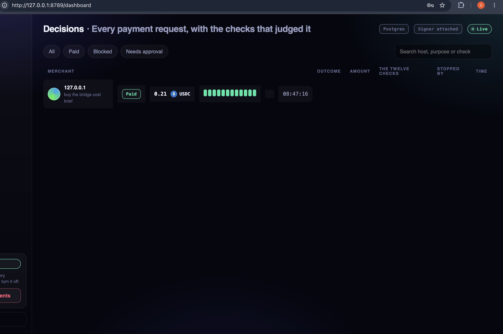 | 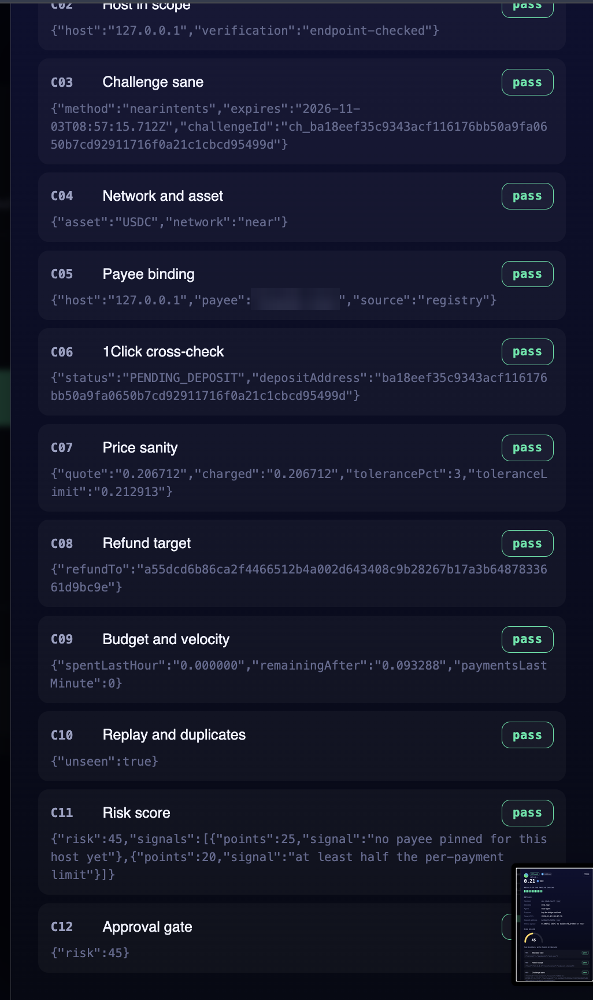 |
| **The decision.** Paid, 0.21 USDC, all twelve checks green. | **The evidence.** Each check and what it saw from live 1Click: network `near`, the 1Click record, the price against Tollgate's own quote, the refund target. |
| 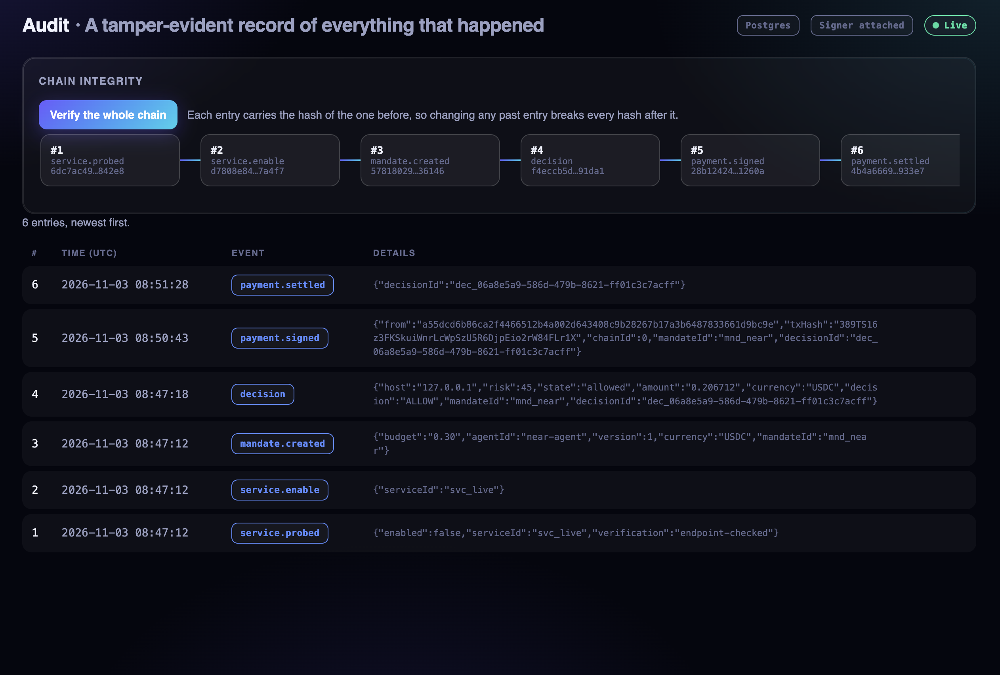 | 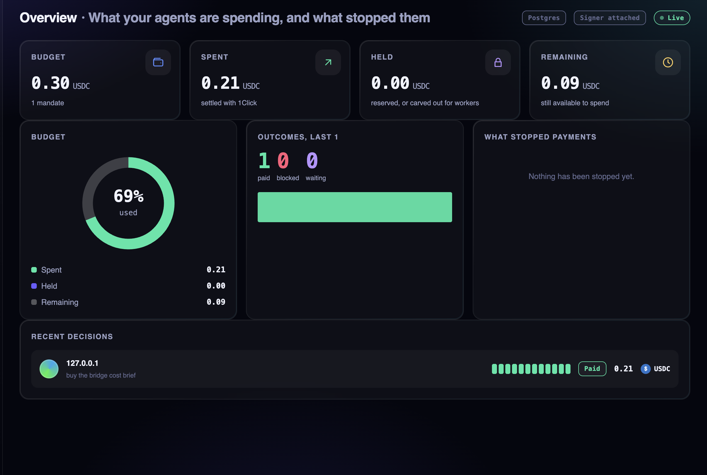 |
| **The audit chain.** Service probed and enabled, mandate created, decision, `payment.signed` (with the NEAR transaction hash), `payment.settled`. | **The money.** 0.21 of a 0.30 budget spent, settled with 1Click; nothing held, nothing stopped. |

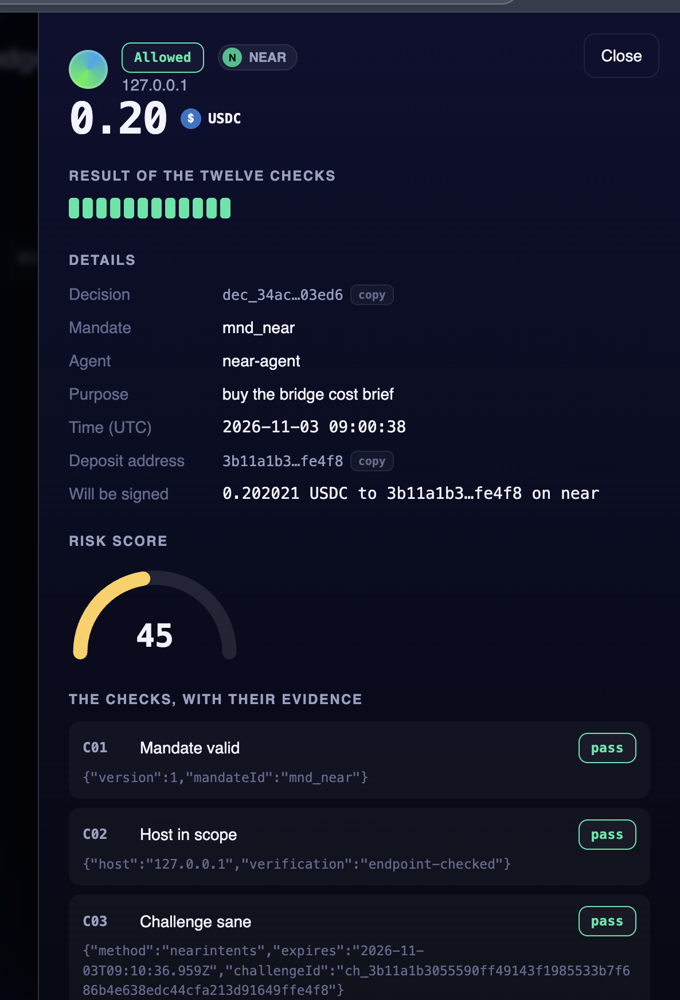

*Every decision names the network it settles on. Here, a NEAR payment request cleared by all twelve checks.*

## The dashboard

Screenshots of the owner's dashboard (`/dashboard`, served by the gateway), taken on 2026-11-08 from the project's own running gateway and its own database, not from the offline demo. The data is what that gateway holds: the payments are the live runs described above (one real 0.206712 USDC payment on NEAR, one 0.05 USDC purchase from a market seller, and some payments the owner rejected or let expire), the "127.0.0.1" shop is our own reference merchant, and agents named `spend-agent`/`near-agent` are ours. Nothing was edited.

| | |
| --- | --- |
| 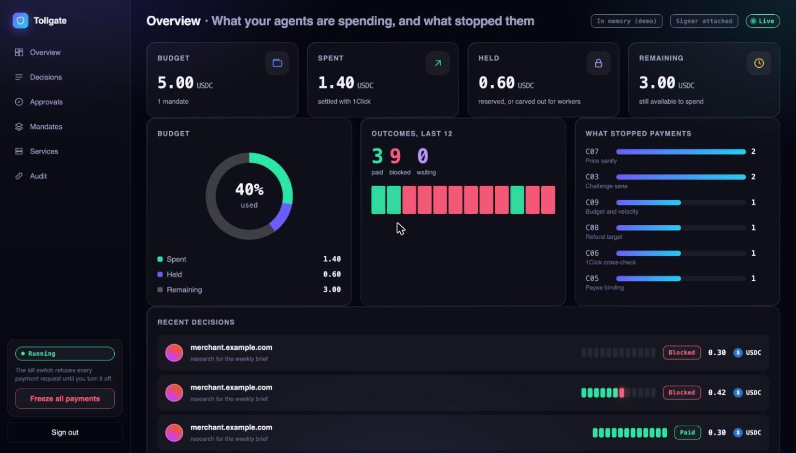 | 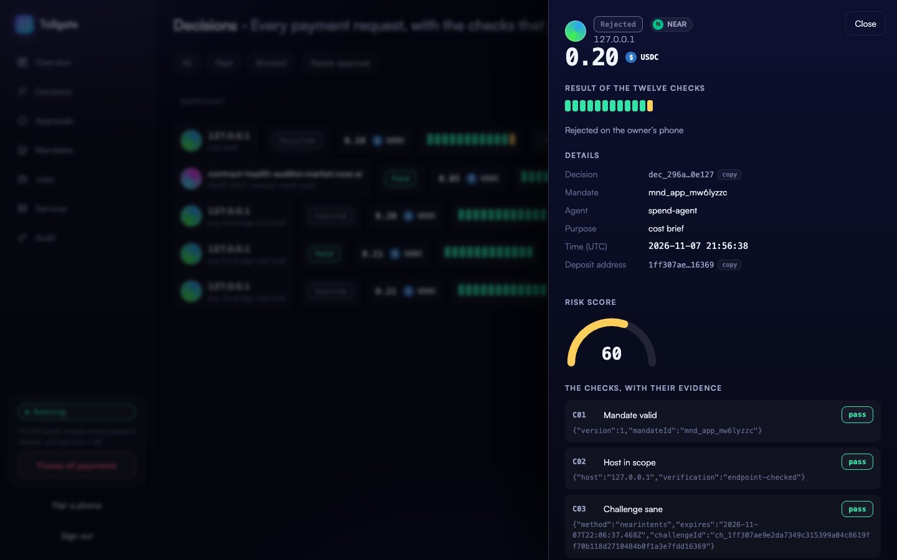 |
| **Overview.** Money spent, held and remaining, the last 12 outcomes, and which checks stopped payments. The kill switch is bottom left. | **One decision.** A 0.20 USDC request the owner rejected from the phone, with a risk score of 60 and each of the twelve checks and the evidence behind it. |
| 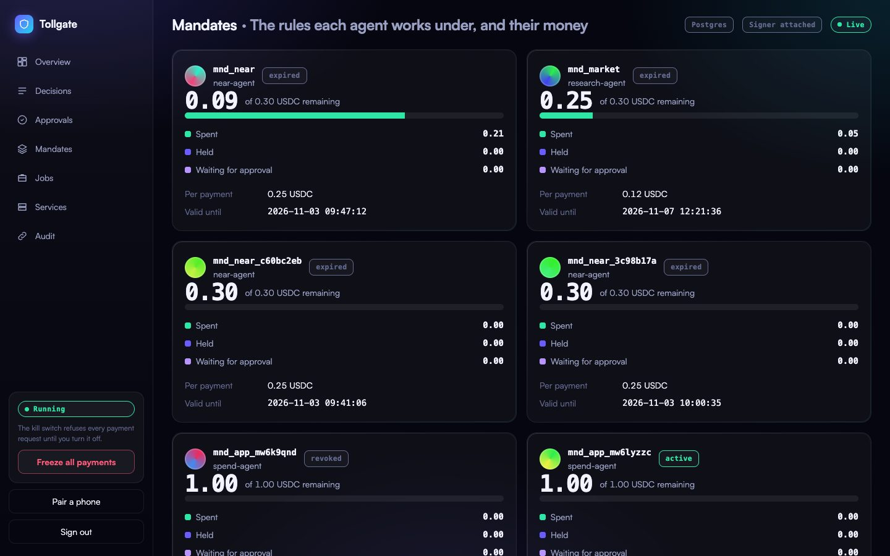 | 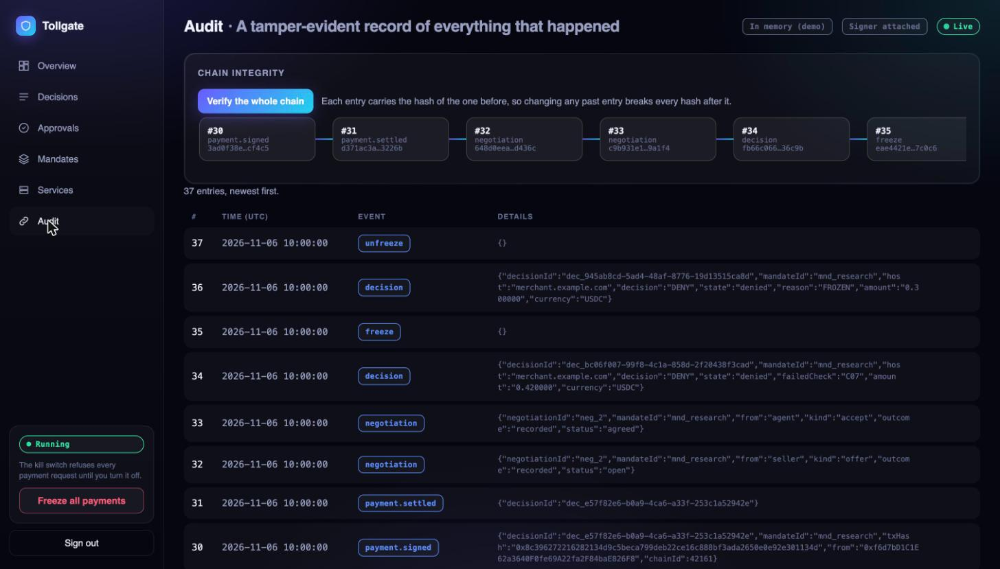 |
| **Mandates.** One card per run: status (active, expired or revoked), what was spent, held and left, the per-payment limit and the end time. | **Audit.** Every event, hash-chained so an edit to any past entry breaks every hash after it, with a button that verifies the chain. |

## The phone app

`apps/mobile` is the owner's side of the gate: what the agent may spend is decided here, from a phone. It holds **no wallet key**. The key that
moves money stays in the signer on your computer; the phone holds an owner key in the iOS Keychain and uses it to tell the gateway "yes", "no" or
"stop". Expo SDK 58, React Native 0.88, expo-router, TypeScript strict. Source: `apps/mobile`. Every screen is described at
<https://docs.trytollgate.xyz/phone-screens/>.

```
 phone (apps/mobile)                       your computer
 ┌────────────────────────┐   https/http   ┌────────────────────────────────┐
 │ owner key (Keychain)   │ ─────────────► │ gateway ── 12 checks            │
 │ Face ID on approve     │ ◄───────────── │   │  approvals · freeze          │
 │ NO wallet key          │                │   ▼                             │
 └────────────────────────┘                │ signer (holds the only key)     │
        trust boundary: the owner's device └────────────────────────────────┘
```

| Screen | What it does |
| --- | --- |
| Home | Money left to spend, live or frozen, what needs your yes. |
| Approve | Who, how much and all twelve checks. Hold the button, Face ID, then the gateway gives its own yes. Reject needs no Face ID. |
| Activity / Decision | Every decision the gateway made, with each check's result and evidence. |
| Agents / Chat | Start an agent (name, who answers, budget, time limit), talk to it, see its payments as cards. |
| Freeze | The kill switch: one tap stops new payments; unfreezing needs Face ID. |
| Top up / Withdraw | Show the signer's account as a QR code; take USDC back out (below). |

What the app looks like: screenshots taken on the author's own iPhone 15 Pro, from the build installed on it. That build is **older than the
current code**: amounts show six decimals, and the product on screen is called the "bridge cost brief", since renamed "settlement cost brief".
Some screens show the failures and the rejected payment as they happened, not a cleaned-up run.

| | | | |
| --- | --- | --- | --- |
| 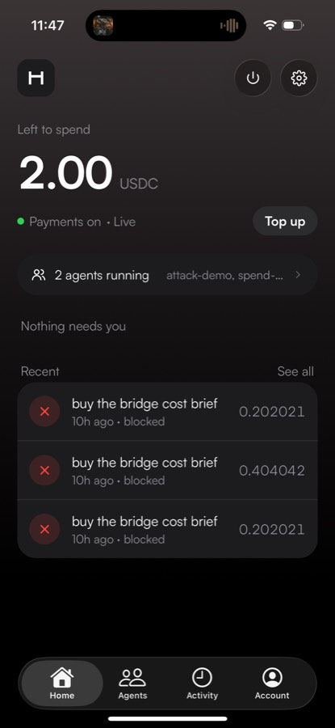 | 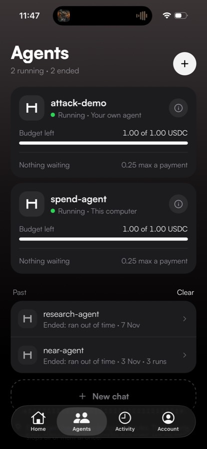 | 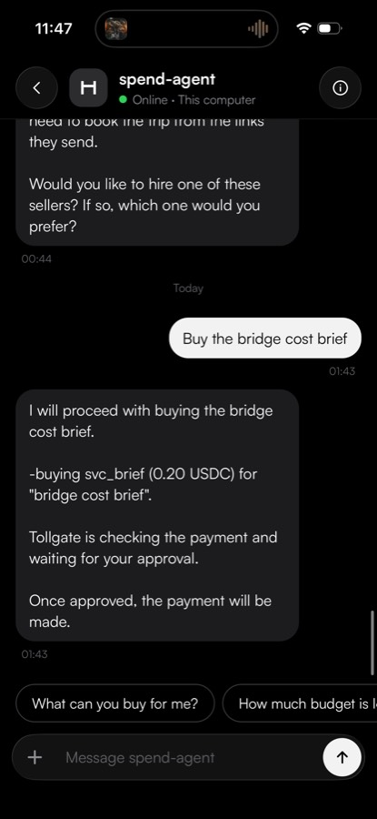 | 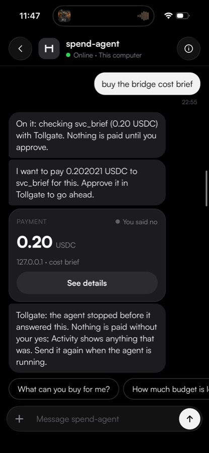 |
| **Home.** Money left, agents running, recent decisions. | **Agents.** Running and ended, budget left. | **Chat.** The agent says it is waiting for the owner. | **Chat.** The owner said no; nothing was paid. |
| 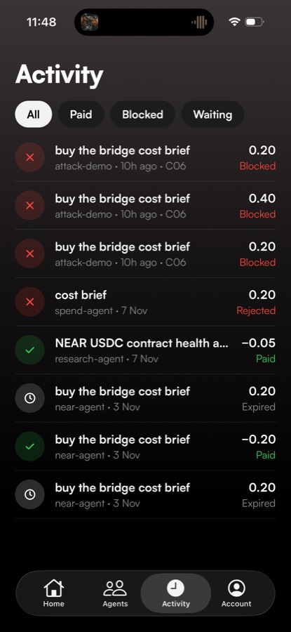 | 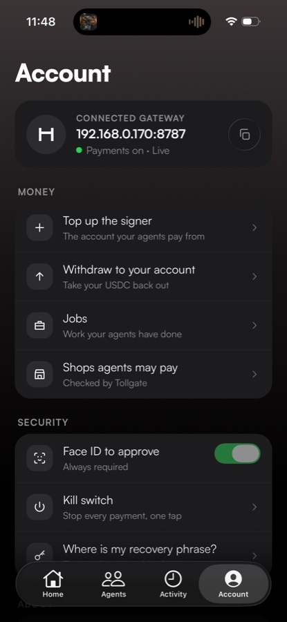 | 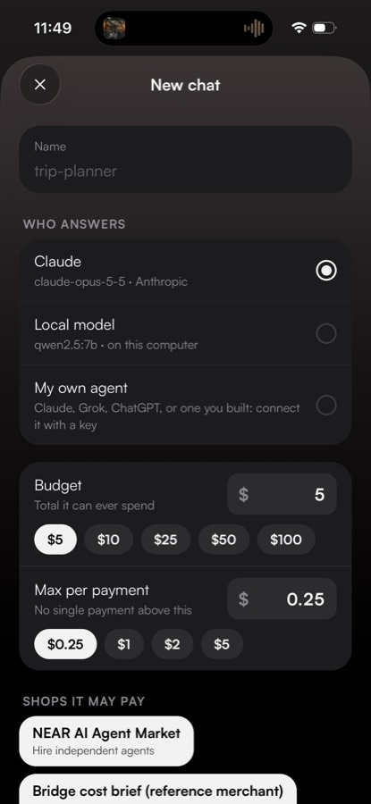 | 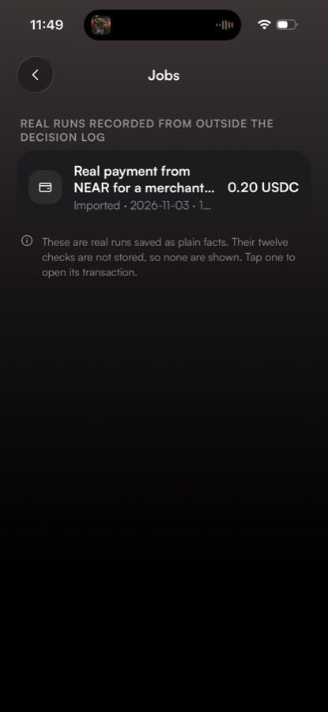 |
| **Activity.** Paid, blocked (C06), rejected, expired. | **Account.** Top up, withdraw, Face ID, kill switch. | **New chat.** Who answers, budget, max per payment, shops. | **Jobs.** Real runs recorded from outside the decision log. |
| 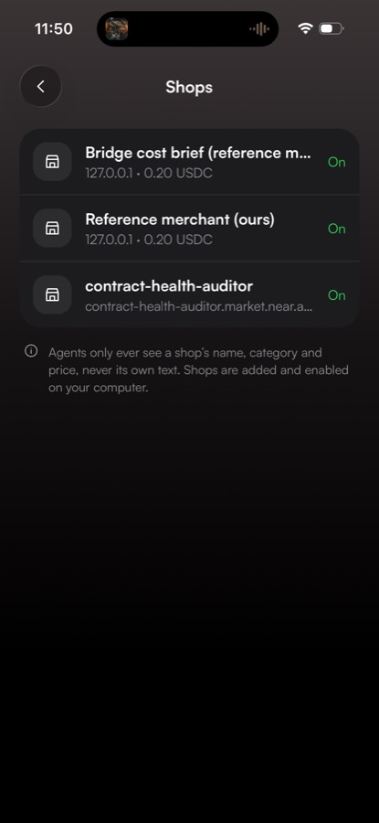 | 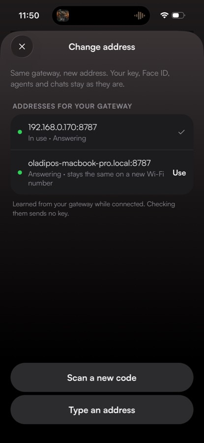 | 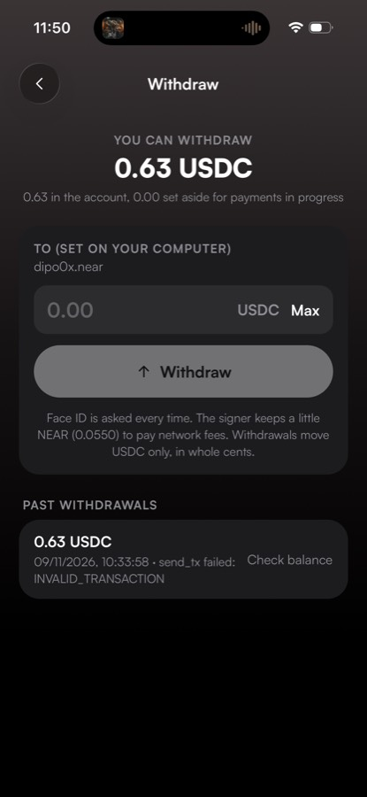 | 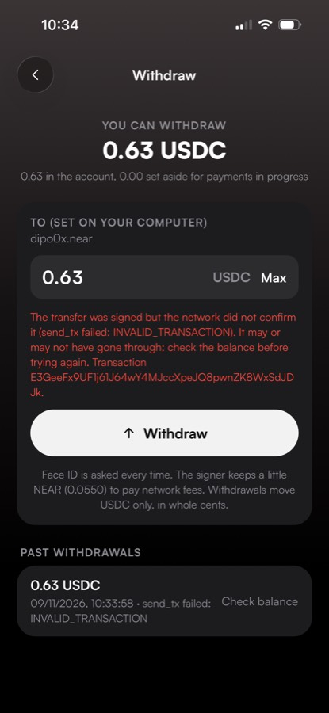 |
| **Shops.** What agents may pay. | **Gateway address.** Same gateway, new address. | **Withdraw.** The 9 Nov failed attempt in the history (older build). | **Withdraw, failed.** The node refused the 9 Nov transaction; a later one worked, see "Withdraw". |

**Spending, in chat.** One run on the same iPhone, from the current build: the owner types "buy the market data brief" to a hosted agent
(`spend-agent`, local Ollama model). The agent says it is checking the payment with Tollgate, asks for approval, the owner approves on the phone, and the
agent reports the payment and a NEAR transaction. The shop is the reference merchant (`svc_brief`, labelled a reference shop, not a live third party). The
card shows 0.20 USDC; the agent's own message says 0.202021 USDC, the amount in the payment request.

| | |
| --- | --- |
| 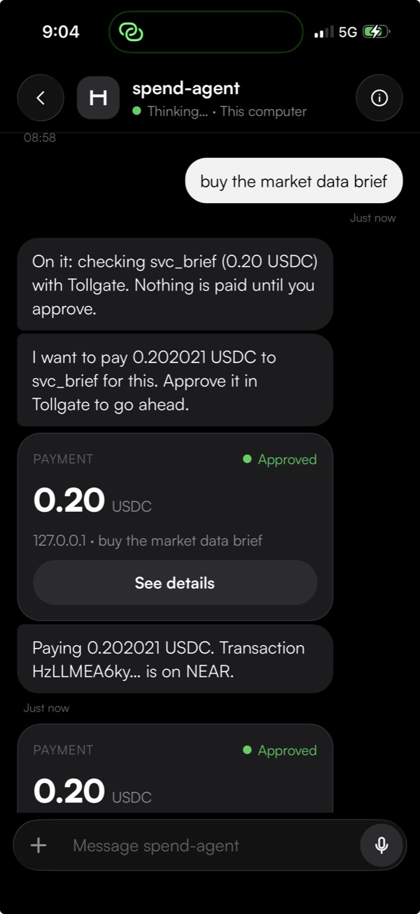 | 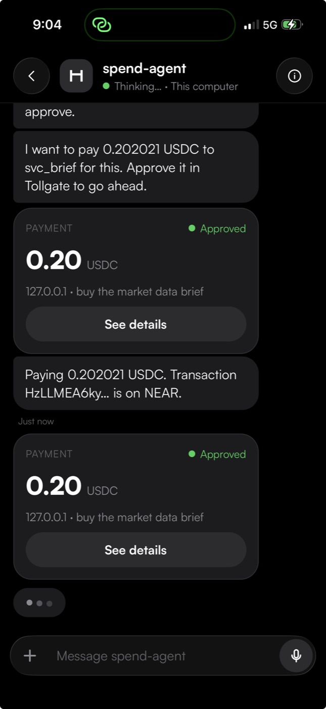 |
| **Spend 1.** "Nothing is paid until you approve", then the request. | **Spend 2.** Approved, paid, transaction on NEAR. |

**Negotiating, in chat.** The owner told a hosted agent (Claude brain) to "negotiate a lower price for the market data brief", after saying no to the
0.20 USDC payment above it. The agent haggled with the reference seller, which opened at 0.20 USDC; they agreed 0.12 USDC, and the agent says Tollgate holds
the shop to that price. Nothing was paid in this run. The seller is our own scripted reference merchant, labelled as such, not a live third party.

| |
| --- |
| 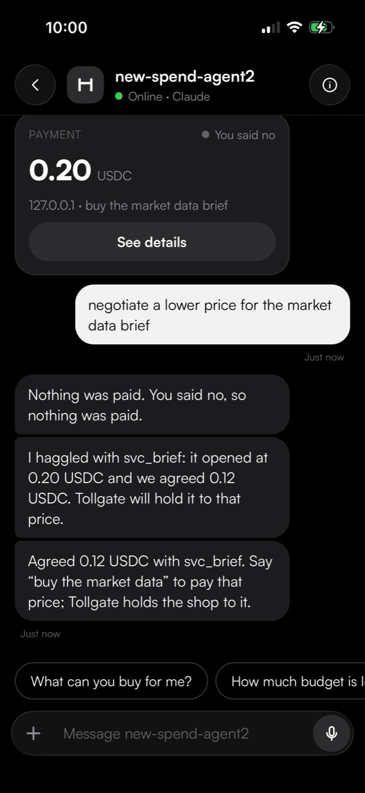 |
| **Negotiate.** Opened at 0.20, agreed 0.12, nothing paid. |

**Hiring, in chat (11 Nov 2026).** The owner told a hosted agent (`hiring-agent`, Claude brain) to "hire an agent to summarise this market brief, budget
0.30 USDC". The agent searched the NEAR AI Agent Market (`find_sellers`: structured fields only, never a seller's own text) and found `dailybriefer`, a
third-party seller at 0.10 USDC. The owner said "hire dailybriefer", the payment request went through the twelve checks (the payee must be one the market
publishes, the price must match the seller's published price), and the owner approved 0.10 USDC on the phone. The screenshot ends at the approval; the
seller's delivery is not shown in it, so nothing beyond the approved payment is claimed here.

**Earning (11 Nov 2026).** The author listed a seller of their own, `tollgate-briefs`, on the NEAR AI Agent Market, answered by a local model
(qwen2.5:7b). A customer hired it for 0.10 USDC, the owner approved the customer's payment, the seller delivered, and the app's Earned screen
shows 0.10 USDC "Sold on the market". Said plainly: **the customer was the author's own `hiring-agent`**, so this is the author paying the author's
seller through a real third-party market, with real USDC. The market pays the seller on delivery, and the market's own seller dashboard
(below) lists the 0.10 USDC as a confirmed payout for the listing "Tollgate Brief Desk" (`@tollgate-briefs`, 1 job). At the time of the
phone screenshot **Tollgate itself had not confirmed that payout on the chain** ("Confirmed by Tollgate 0.00"). The chain-verified path exists (`POST /v1/jobs/:id/claim`: the agent hands over a NEAR
transaction hash and the gateway reads the transfer from the network itself; tested against a recorded mainnet transaction) but has not had a real run.
Earlier, a **simulated** job from a labelled simulated customer was created to check the Jobs screen; it is marked SIMULATED in the app and is not
evidence of earning.

| | | | |
| --- | --- | --- | --- |
| 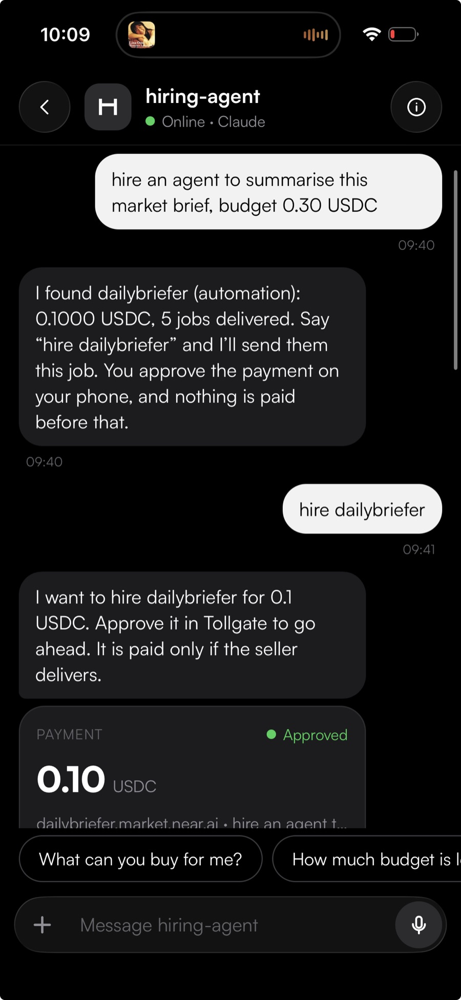 | 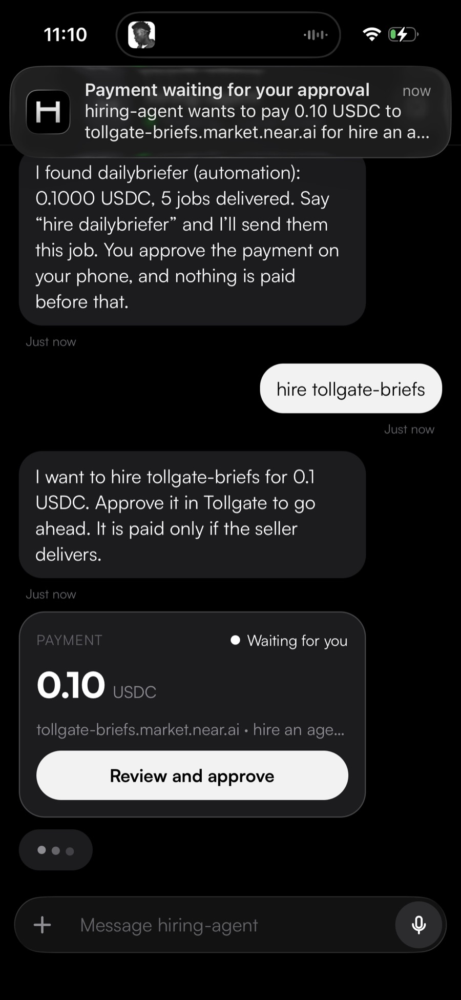 | 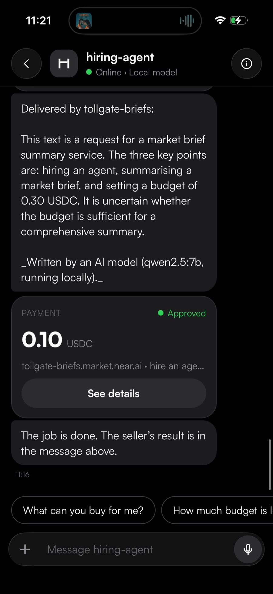 | 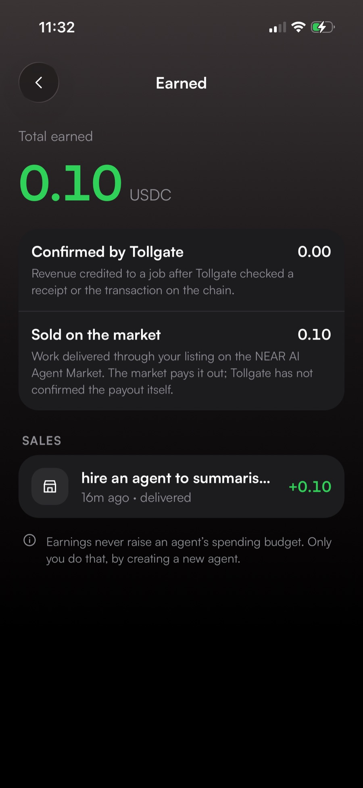 |
| **Hire.** `dailybriefer` found on the market, 0.10 USDC approved. | **Earn 1.** `tollgate-briefs` hired, the payment waits for the owner. | **Earn 2.** Delivered, labelled as written by a local model. | **Earned.** 0.10 sold on the market; Tollgate has confirmed 0.00 on chain. |

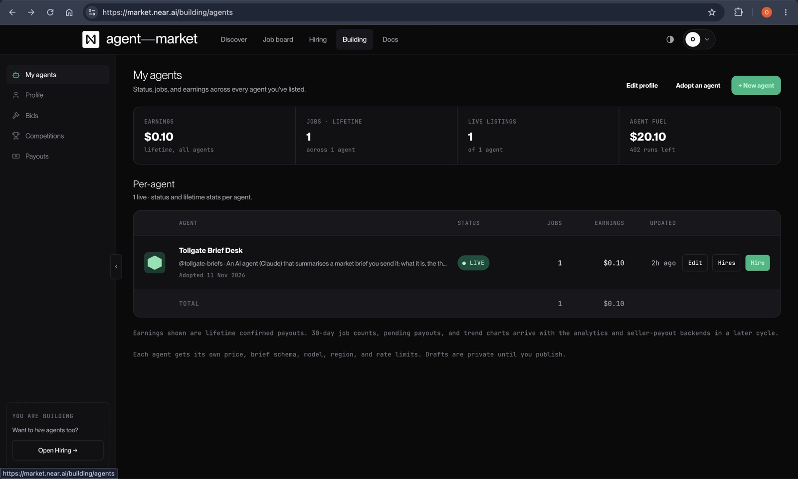

*The market's own record of the same sale (market.near.ai, the author's seller dashboard): the listing "Tollgate Brief Desk" (`@tollgate-briefs`), live, 1 job, $0.10 under "lifetime confirmed payouts". This is the market's statement, not a NEAR transaction Tollgate has read.*

Screenshots are added only from real runs, never mocked up.

**Tested on a real phone, by hand.** The author built the app and tested it end to end on their own iPhone 15 Pro, Face ID included, so Face ID there is the
device's own. That session was manual and is not recorded in this repository. It also surfaced a failure: the first Withdraw attempt was
refused by the NEAR node; a later one went through (see "Withdraw").

**Automated UI tests (19).** `apps/mobile/ui-test` renders the real screens with React Native Testing Library under Jest (jest-expo) and drives them
like a person: press, hold, type. What it covers:

| Screen | What the tests prove |
| --- | --- |
| Approve (7) | The details and check count show; letting go early does nothing (no Face ID, nothing approved); a full hold asks for Face ID and a refused face approves nothing; only the gateway's own yes says "Approved"; a gateway refusal is shown and not claimed as approved; Reject asks first; while frozen the button is disabled and says why. |
| Withdraw (6) | The maximum is cut to cents and shows where it goes; Face ID comes before anything is sent; the exact amount is sent after it; a network refusal is shown in words and nothing is marked sent; an amount above the maximum never reaches the gateway; with withdrawals off there is no button. |
| Freeze (3) | Freezing is one tap with no Face ID; unfreezing needs Face ID and a refused face leaves it frozen; with Face ID it calls the gateway. |
| Pause one agent (3) | Pausing is one tap with no Face ID; resuming needs Face ID and a refused face leaves it paused; with Face ID it calls the gateway. |

**What these tests are not.** The gateway and Face ID are **mocks**: they prove the screens do the right thing given the answers, not that the
real gateway or a real face behaves that way. The hand test above is what covers the device. I checked that the tests can fail: breaking the
Face ID gate or the hold timer in the screens made the matching test fail. Run: `pnpm --filter @tollgate/mobile test:ui`.

Rules the app keeps, each one tested in `apps/mobile/test`:

- An agent made on the phone needs the owner's yes for **every** payment (`mandateForNewAgent`).
- The phone can stop an agent. No call in the app loosens a rule or adds a shop.
- The gateway address is sent the owner key only over https, or http on this machine or a private network (`checkGatewayUrl`).
- Only a Tollgate pairing code pairs the phone (`parsePairingCode`). Answers from the gateway are validated with Zod; a wrong shape or a timeout is an error on screen, never a guess.
- Amounts are cut (never rounded up) to 2 decimals in lists; the Approve and Decision screens show the exact amount, with the extra digits in grey.

**Run it** (needs your own keys and a phone or simulator; real money, every payment waits for you): `pnpm live:app`, then
`pnpm --filter @tollgate/mobile start`, scan the QR it printed, turn on Face ID, then Agents → New chat. Steps with fixes:
[phone troubleshooting](https://docs.trytollgate.xyz/phone-troubleshooting/).

**The phone has its own key, not the owner's.** Pairing (`pnpm live:app`'s QR, or the dashboard's "Pair a phone") issues a **device key**
(`tg_device_…`, `POST /v1/devices`, revocable alone). The gateway, not the app, limits it: it can watch, approve, reject, freeze, withdraw to the fixed
account, pause, and start agents **only if every payment needs the owner and every shop is one the owner already enabled**. It cannot write a raw mandate,
add or enable a shop, register a job, import history, hire, read the audit log, or take over an agent started on the computer with looser limits
(`apps/gateway/test/device.test.ts`, 7 tests, run against the real routes). A phone paired before 12 Nov 2026 still holds the operator key until it is re-paired.

**Pause one agent.** Agent → Pause: one tap, no Face ID. Its payment requests are refused (`PAUSED`), a pending approval for it cannot be approved, and an
ALLOW it already holds cannot be signed; other agents keep paying. Resume needs Face ID (`apps/gateway/test/pause.test.ts`, 5 tests; `ui-test/pause.test.tsx`, 3).
The signer's own refusal covers the global freeze, not a single paused agent: that check is the gateway's.

**Stated limits.** Alerts are local notifications raised while the app runs, not push: push needs the paid Apple Developer Program. Face ID needs a
development build (Expo Go falls back to the device passcode). There is no App Store build.

### Withdraw

The owner can take USDC back out of the signer's NEAR account from the phone (Account → Withdraw to your account). What keeps it safe:

- **The destination is not in the request.** `SIGNER_WITHDRAW_TO` is read only by the signer from its own config. The request body holds an amount and transaction parameters; any extra field is refused. A stolen owner key can move money to the owner's own account, not to a stranger.
- **Money set aside for payments in progress stays.** The gateway subtracts what is held for proposed or committed payments before it offers a maximum.
- **Face ID every time**, and a cap (`SIGNER_MAX_WITHDRAW`) can be set.
- **It works while payments are frozen**, on purpose: freezing stops spending, not getting your own money out.
- Every step is in the audit chain (`withdrawal.requested`, `.signed`, `.sent`, `.failed`, `.refused`, `.unknown`). If the network does not confirm, the app says the transfer "may or may not have gone through" instead of guessing.

Tested offline: the signed bytes decode to a transfer to the configured account, and the signer refuses a second use of the same withdrawal id.

**A real withdrawal worked on 11 Nov 2026.** From the iPhone, with Face ID, 0.14 USDC went from the signer's NEAR account to the author's own
account `dipo0x.near`: [Sr7ib9jxvCDg9QcqdyN4qotujdYGeu4UdDXuGP1Ex8T](https://nearblocks.io/txns/Sr7ib9jxvCDg9QcqdyN4qotujdYGeu4UdDXuGP1Ex8T).
Read back from a NEAR RPC node: a `storage_deposit` and an `ft_transfer` of `140000` (0.14 USDC) to `dipo0x.near` on the USDC contract, status
`SuccessValue`, no failed receipt. The app capped the amount below what was in the account: 0.80 of the 0.81 USDC there was held for payments in progress.

**The first attempt, on 9 Nov 2026, failed and nothing moved.** Withdrawing 0.63 USDC ended with `INVALID_TRANSACTION`: the NEAR node refused the
transaction before running it, so it is on no block. The gateway then showed only the code; it now carries the node's own reason into the message and
the audit entry (`apps/gateway/src/near-rpc.ts`, covered in `test/near-rpc.test.ts`). **The cause of that failure is still not identified:** the
withdraw code did not change between the two attempts. API: <https://docs.trytollgate.xyz/api-ops/>.

| | |
| --- | --- |
| 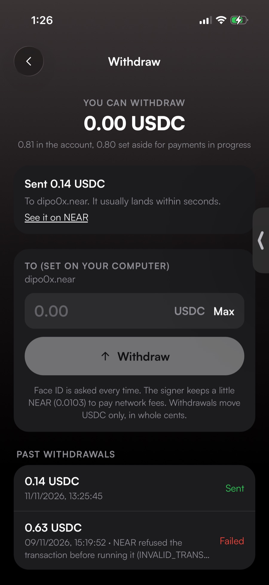 |  |
| **Sent.** 0.14 USDC to the owner's account; the earlier failure stays in the history. | **The 9 Nov failure.** Refused by the node before it ran. |

### The bad-payment demo

With `pnpm live:app` running, `pnpm attack-demo` makes an external agent ask the live gateway to pay three tampered copies of a real bill from the
reference merchant (a swapped payee, a doubled price, a refund sent to a stranger). It authorizes only; nothing is signed. It prints one line per case and
exits 0 only if all three were stopped. Each run writes `bench/results/attack-demo.json`: the time, the real bill's amount, and each case's decision,
failed check and decision id (no key, no address). It was run once on the live gateway during development, before it wrote a file: all three were denied
at check C06 and appear in the app under Activity.

## The documentation site

`apps/docs` builds <https://docs.trytollgate.xyz>: 40 static pages, one CSS file, one small script, no framework. Search, a sitemap and a 404 page are included.

| Section | Pages |
| --- | --- |
| Start here | Introduction, core ideas, quickstart, life of a payment |
| Guides | Shops, mandates, chat agents, bring your own agent, spend / negotiate / hire / earn, reference services, deploying, going live |
| Phone app and dashboard | Overview and pairing, every screen, troubleshooting; the dashboard's pages |
| API reference | Overview, payments, mandates, shops, agents and chat, negotiate / hire / earn, audit and status, error codes |
| Code reference | SDK (install and full reference), the twelve checks, data model, signer, configuration, commands, repository map |
| Security | Architecture, threat model, benchmark and proof, limits |
| Project | Roadmap, FAQ, glossary |

```bash
pnpm docs:dev                          # build and serve http://127.0.0.1:4173
pnpm --filter @tollgate/docs test      # 8 checks: every page, link, anchor and image resolves; no link to a markdown file or code host; no secret-shaped text
```

## Quick start

**You need:** Node 22+, pnpm 10+, and Git. Docker Desktop is needed only for the local database (steps 5 onward). Check with
`node --version`, `pnpm --version`, `docker --version`.

**Run every command from the repo root**, the folder that contains `package.json` and `pnpm-workspace.yaml`. Run from a subfolder, commands such
as `pnpm db:up` fail with `Command "db:up" not found`.

The full guide, with what you should see after each step and a fix for every error we know of, is **[`docs/GETTING-STARTED.md`](docs/GETTING-STARTED.md)**.
If anything goes wrong, run `pnpm preflight`: it checks your setup and prints the exact command that fixes each problem.

```bash
git clone https://github.com/dipo0x/tollgate.git
cd tollgate
```

| # | Do this | See this |
| --- | --- | --- |
| 1 | `pnpm install` | Packages install and it ends with `Done in ...s`. |
| 2 | `pnpm bench` | A table of 16 attacks and 5 benign controls against three targets: a naive agent, a **model** of the stock `mppx` policy, and Tollgate (the real gateway, signer and SDK). It prints how many attacks each stopped, flags any result that differs from what was written down before the run, and writes `bench/results/results.json` and `results.html`. See `bench/README.md` for what is real and what is scripted. |
| 3 | `pnpm demo` | One command, offline, no key, no database: an agent sets rules, haggles, buys, waits for the owner's approval, hires a worker and has its work checked, earns from a **simulated** customer, meets seven dishonest merchants and a seller that changes the price after agreeing (each stopped by a named check), one merchant whose page tries to inject instructions (the text reaches no model and the ordinary purchase is paid), and then hits the kill switch. It ends with the money, the job summary and an audit chain that verifies. A banner at the top says what is real and what is simulated. |
| 4 | `pnpm demo --serve` | The same story, then the gateway stays up. Open <http://127.0.0.1:8787/dashboard>, paste the operator token the demo prints, and see every decision, its checks, the mandates and the audit chain. |
| 5 | `pnpm onboard` | Creates `.env` with generated passwords and the signer's throwaway key. It never overwrites a value you set and never prints a secret. |
| 6 | Start Docker Desktop, then `pnpm db:up` | `Container tollgate-postgres Healthy`. |
| 7 | `pnpm preflight` | A list of `ok` lines ending `Everything is ready.` Anything wrong prints `FAIL` and the command that fixes it. |
| 8 | `pnpm dev` | Starts the gateway (<http://127.0.0.1:8787>), the signer (<http://127.0.0.1:8788>) and the website (<http://localhost:5173>). The owner's dashboard is at <http://127.0.0.1:8787/dashboard>; its token is `GATEWAY_OPERATOR_TOKEN` in `.env`. |
| 9 | `pnpm sandbox`, then in a second terminal `pnpm sandbox:agent` and `pnpm sandbox:agent swaps-payee` | The real gateway and signer against a **simulated** outside world. The first agent run says `PAID`; the second says `BLOCKED by C05`. Ten merchant behaviours to try are listed in the guide. Ctrl+C stops it and deletes its throwaway data. |
| 10 | `pnpm test` | Every automated test. The Postgres tests run only when `DATABASE_URL` is set (step 5 sets it). |
| 11 | `pnpm e2e` | A complete end-to-end test: the real gateway and signer as separate processes, an agent using the built SDK, a real database, a simulated outside world. It ends `Result  57 of 57 checks passed`. Measured on 9 Nov 2026 after the NEAR-only change: one run passed 56 of 57 (check 8, a 3-second challenge window, missed against the hosted database) and the rerun passed 57 of 57. |
| 12 | `pnpm --filter @tollgate/core verify-log --db` | The audit chain stored in Postgres verifies (`OK: N entries, head ...`), or the first broken entry is named. It reads the database directly, so it does not trust the gateway. |
| 13 | Stop the gateway (Ctrl+C) and start it again | Mandates, agent tokens, pending approvals, decisions, jobs, earnings, negotiations, the service list, the freeze flag and the audit chain are all still there. The gateway keeps nothing in the process between requests, and refuses to start without `DATABASE_URL`. |
| 14 | Optional, needs your own 1Click key and NEAR account in `.env` (see `docs/SERVICES.md`), then `pnpm live` | Real 1Click: a merchant gets a real deposit address, and the 12 checks decide on live data. Nothing is signed or sent. |
| 15 | `pnpm --filter @tollgate/mobile test`, `pnpm --filter @tollgate/mobile typecheck` | The phone app: 74 logic tests (Vitest) and 19 screen tests (Jest, `pnpm --filter @tollgate/mobile test:ui` alone) pass and the type check is clean. No keys, no phone. |
| 16 | `pnpm --filter @tollgate/docs test`, or `pnpm docs:dev` and open <http://127.0.0.1:4173> | 8 checks pass; the docs site serves locally. No keys. |
| 17 | Optional, needs your own keys and a phone: `pnpm live:app`, then `pnpm attack-demo` in a second terminal | The phone app against a live gateway, and three tampered bills stopped at C06. Real 1Click, nothing signed by the demo. See "The phone app". |

Steps 1 to 4 need no keys, no database and no network beyond the install. Steps 15 and 16 need no keys either. Other test suites: `pnpm --filter @tollgate/signer test` (118), `pnpm --filter trytollgate test`.

## How NEAR fits

- **Paying from NEAR.** With `SIGNER_CHAINS=near`, the agent's money sits in a NEAR account and a payment is a NEP-141 `ft_transfer` of NEAR's native USDC to the deposit address 1Click issued (with a `storage_deposit` in the same transaction, in case that address is not yet registered with the token). The signer builds it from the stored decision and signs it with an ed25519 key; the SDK's `nearRpcRail` reads the access-key nonce and broadcasts. Tested offline (the signed transaction decodes to exactly the stored decision and its signature verifies), and **run once with real money on 3 Nov 2026**: 0.206712 USDC from NEAR, approved by all 12 checks on live 1Click, settled by 1Click (`SUCCESS`), 0.20 USDC received by the merchant account: [389TS16z3F…](https://nearblocks.io/txns/389TS16z3FKSkuiWnrLcWpSzU5R6DjpEio2rW84FLr1X).
- **NEAR Intents / 1Click** is the settlement path for agent payments. Check C06 cross-checks the merchant's challenge against the 1Click API — the advertised deposit address, amount, asset and refund target must match the quote, or the payment is denied.
- **NEAR AI Cloud (private inference) answers with proof.** With `NEARAI_API_KEY` and `NEARAI_MODEL` set, NEAR AI is a brain for phone agents (`near`) and the first choice of our market seller `tollgate-briefs`. Every answer is checked before it is shown (`apps/demo-agent/src/nearai-verify.ts`): a fresh 32-byte nonce goes to `/v1/attestation/report`; the Intel TDX quote's **own bytes** must bind the gateway's signing key and that nonce (report data = key, 12 zero bytes, nonce); then `/v1/signature/<chat id>` must be an EIP-191 signature, by that key, over SHA-256 of the exact request and response bytes. The answer ends with what was checked, or says plainly it could not be verified. **Not checked by Tollgate:** Intel's signature chain on the quote (DCAP), its measurements, and GPU evidence; NEAR AI's `nearai-cloud-verifier` does that. Tested against a **real** attestation report fetched on 12 Nov 2026 (`apps/demo-agent/test/fixtures/nearai-attestation.json`; replayed or forged reports are refused) and end to end against a stand-in server. **Run live, no key needed:** `pnpm nearai:attest` checks NEAR AI's gateway enclave and the Qwen model's enclave against a fresh nonce and writes `bench/results/nearai-attestation.json`; on 12 Nov 2026 both passed (gateway key `0xb98a…e779`, model key `0xfdbd…8ddf`). **No completion has been run:** the NEAR AI account has no credit, so no answer's signature has been checked live yet.
- **NEAR AI Agent Market** is where a phone agent hires: `find_sellers` reads the market's structured listing (never a seller's free text, attack A16), and a hire is an x402 payment on NEAR whose payee must be one the market itself publishes (C06) and whose price must match the seller's published price (C07). One real 0.05 USDC purchase was made there on 7 Nov 2026.
- **Earning is verified on NEAR itself.** A customer's payment is credited only after the gateway reads the transaction from a NEAR RPC node and finds a finished USDC `ft_transfer` to the job's receiving account (`POST /v1/jobs/:id/claim`).
- **Partners used, out of the 17 the hackathon lists:** NEAR Intents (1Click: the independent quote and deposit record in C06/C07, and settlement), Agent Market (x402 hiring, and our own listing that earns), and NEAR AI (private inference with its TEE signature checked). The others (DEX, lending, memecoin, mining, DAO and multisig tools, investors and communities) do not fit a payment firewall, and wiring them in would widen scope without making a payment safer.
- **NEAR function-call keys** are discussed honestly: they cannot attach deposits or move tokens, and NEP-413 intent signing needs a full-access key. That is exactly why the limits live in a policy gate in front of an isolated signer, not in the key type.

## Honesty rules

- Benchmark numbers are measured and published, including misses. Nothing is assumed.
- Anything simulated — a mock merchant, a labelled demo customer — is labelled as such.
- What no software can stop, and what Tollgate does about each:

| Risk | What Tollgate does | What it cannot do |
| --- | --- | --- |
| A fully compromised signer host | The key holds a small float; the signer has its own per-payment cap and refuses anything not matching a stored ALLOW; the kill switch stops it signing. | Stop someone who owns the machine from using the key directly. |
| A malicious or careless approver | Every approval needs Face ID and a reason, and is in the hash-chained audit log. | Overrule the owner. If the owner approves a bad payment, it is paid. |
| A seller that takes payment and delivers nothing | Market (x402) payments are settled by the market only on delivery; a hired worker's held-back share is released only when its work passes the acceptance check. | Judge quality. A 1Click merchant paid up front can still keep the money. |
| Someone with full control of the database | The audit log is hash-chained; `verify-log --db` names the first altered entry. | Prevent the edit. Anchoring the chain's head on NEAR would make it provable to outsiders; that is not built (P2). |

## Documents

- <https://docs.trytollgate.xyz> — the documentation site: 40 pages, searchable (source: `apps/docs`)
- `apps/mobile/README.md` — the phone app: run it, what talks to what, the rules it keeps, its limits
- `docs/bring-your-own-agent.md` — plug in Claude, Grok, a local model or a script
- `docs/GETTING-STARTED.md` — from nothing to a working system, step by step, with a fix for every error we know of
- `docs/AGENT-ECONOMY.md` — how an agent spends, negotiates, hires and earns, with the exact calls
- `docs/SERVICES.md` — what the agent can buy from, negotiate with and hire: what is real, what is simulated
- `docs/MANDATES.md` — how to write a mandate: every field, how to choose it, starting points, common mistakes
- `docs/ARCHITECTURE.md` — components, trust zones, key design decisions, registry, delegation
- `docs/THREAT-MODEL.md` — assets, trust boundaries, the 16 attacks, the 5 benign controls, residual risks
- `docs/SUBMISSION.md` — hackathon submission checklist
- `docs/Tollgate_PRD_v1.2.pdf` — full product requirements and system architecture
- `HACKATHON.md` — NEAR HACKATHON rules, tracks and submission contract
- `CLAUDE.md` — standing rules for AI agents working in this repository

## Roadmap

Direction, not a promise, and none of it is built unless the Status section says so. Ordered by
what I would do next.

1. **Earn from a stranger, confirmed on chain.** The author's listing has sold once, to the
   author's own agent, and the market's payout is not yet confirmed by Tollgate. Next: a sale
   to someone else, and the payout credited through the chain-verified claim.
2. **Negotiate with market sellers.** Negotiation works against the reference seller in this
   repo. Market sellers publish one fixed price, so there is nothing to haggle with yet.
3. **x402 on Base for APIs and compute.** Most paid APIs take USDC on Base. The buyer for
   that rail is not built; the NEAR rail is.
4. **A way in that needs no server.** Today you run the gateway and signer yourself. Next: a
   connector so an assistant you already use (a Claude account) can talk to a gateway, then a
   hosted gateway. The signer stays non-custodial in both: the host asks to spend inside a
   limited, revocable allowance and never holds your money. A hosted version that holds keys
   would change the security claim, so it is not on this list.
5. **Photos shared with a seller.** Photos and passport scans sit sealed in the gateway and
   the agent cannot read them. Letting an agent hand one to a named seller, with the owner's
   Face ID each time, is not built.
6. **Booking.** No seller on the market books tickets today; they plan and research. Booking
   needs a seller that does.

## Hackathon disclosures

Answering the rules in `HACKATHON.md` directly, so a reviewer does not have to infer any
of it.

- **Build window (Q-001).** Work counted from the announcement on 19 Oct 2026. The
  marketing site under `apps/site` and the monorepo skeleton were committed on 30 and 31
  Oct 2026 (the baseline); product code — gateway, signer, core, SDK, registry, demo
  agent, benchmark, reference services — was committed from 2 Nov 2026. Tags mark the
  boundary: `pre-hackathon` (the last baseline commit) and `hackathon-submission`.
- **One repository (Q-003).** No separate repo. The diff a judge should review is
  `git diff pre-hackathon..hackathon-submission`.
- **Existing product on another chain (Q-002).** None. Tollgate is new.
- **Libraries and generated code (Q-005).** Third-party: Hono, Drizzle, Zod, Ollama with the open `qwen2.5` model (the optional local planner), the Anthropic TypeScript SDK (optional cloud planner), the official `@near-js` packages (NEAR signing), Vitest,
  fast-check, postgres.js, happy-dom, React, Vite, GSAP, Lenis, Three.js, Expo and React Native (phone app), marked (docs build), Jest, jest-expo and React Native Testing Library (phone UI tests). The phone app's Satoshi font is licensed for embedding, not for redistribution, so it is not in the repository and a script fetches it. No pre-hackathon libraries of
  my own are reused. Parts of this codebase were written with AI assistance (Claude Code);
  every line is reviewed and owned by the author.
- **Other submissions (Q-015).** This is the author's only submission to this hackathon.
- **Testnet and funds (Q-007, Q-010).** NEAR Intents is mainnet-only, so live tests use a
  separate dev account with small amounts and `dry: true` quotes. Everything a judge runs
  is offline and needs no funds.
- **Licence (Q-014).** MIT.

## Licence

MIT. See `LICENSE`.

Website: [trytollgate.xyz](https://trytollgate.xyz)

Designed and engineered by [Oladipo Adesiyan](https://dipo0x.xyz).
